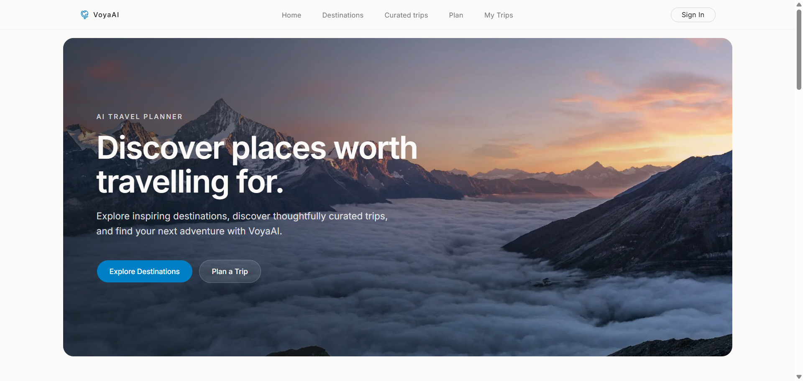
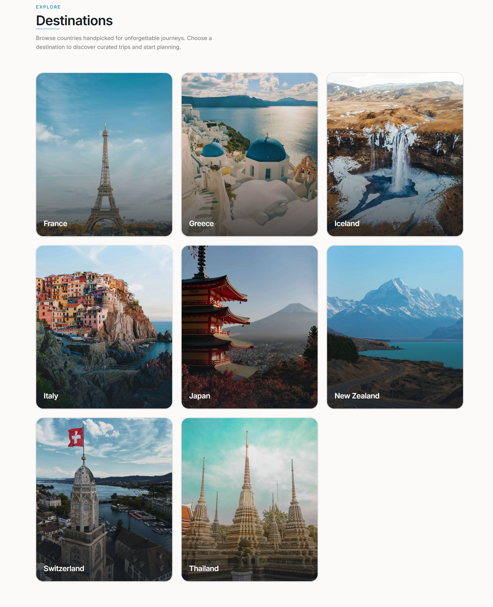
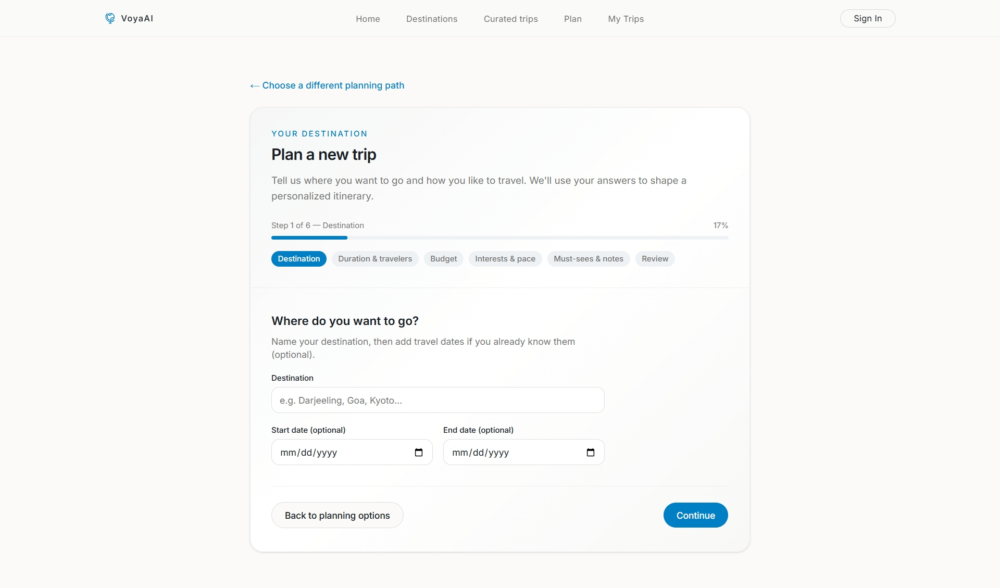
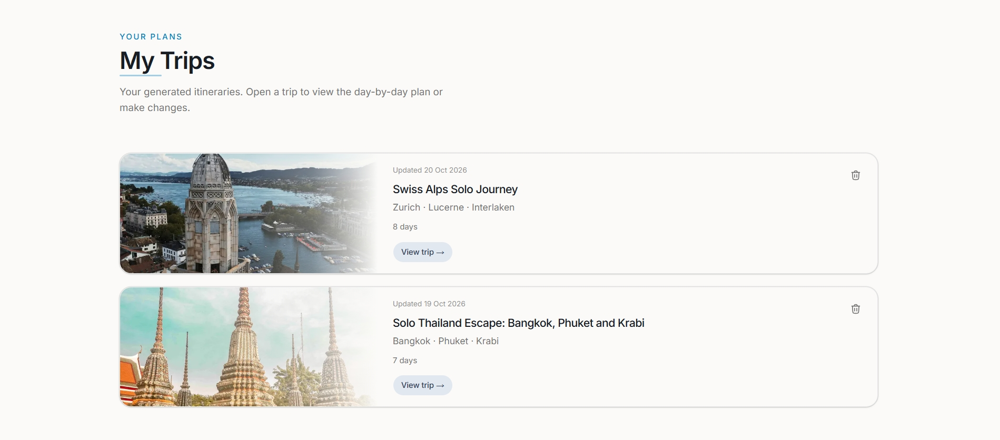

# VoyaAI ✈️

**Turn your travel preferences into a personalized, day-by-day itinerary.**

VoyaAI is an AI-powered travel planning web app built with Next.js. Explore destinations, discover curated trips, generate personalized itineraries, and save your plans for later. You can also revise saved itineraries using natural-language instructions and preview the changes before saving them.

<p align="center">
  
</p>

<p align="center">
  
  
  
  
  
</p>

<p align="center">
  <a href="https://voya-ai-omega.vercel.app/">Live Demo</a>
  ·
  <a href="#getting-started">Getting Started</a>
  ·
  <a href="#how-it-works">How It Works</a>
</p>

---

## Screenshots

|                 Destination discovery                  |                AI trip planner                |
| :----------------------------------------------------: | :-------------------------------------------: |
|  |  |

|               My Trips               |
| :----------------------------------: |
|  |

## Features

- **Explore destinations** — Discover destinations and curated trip ideas.
- **Curated itineraries** — Browse trip templates with structured, day-by-day plans.
- **Personalized AI planning** — Generate itineraries based on destination, travel dates, budget, interests, pace, and other preferences.
- **Flexible trip creation** — Start from scratch or use a curated trip as inspiration.
- **Google authentication** — Sign in to generate and manage your trips.
- **Save and manage trips** — Revisit saved itineraries in My Trips.
- **AI-powered revisions** — Request changes in natural language, preview the updated itinerary, and save only when you're satisfied.
- **Responsive interface** — Plan trips across desktop and mobile screen sizes.

## Tech stack

| Technology                                                                    | Purpose                                                    |
| ----------------------------------------------------------------------------- | ---------------------------------------------------------- |
| [Next.js](https://nextjs.org/)                                                | App Router, pages, server rendering, and API routes        |
| [React](https://react.dev/)                                                   | Interactive user interface                                 |
| JavaScript                                                                    | Application logic and components                           |
| [Tailwind CSS](https://tailwindcss.com/)                                      | Styling and responsive layouts                             |
| [shadcn/ui](https://ui.shadcn.com/) and [Radix UI](https://www.radix-ui.com/) | UI components and accessible interaction primitives        |
| [Prisma](https://www.prisma.io/)                                              | Database access and schema management                      |
| [PostgreSQL](https://www.postgresql.org/)                                     | Persistent application data                                |
| [Better Auth](https://www.better-auth.com/)                                   | Authentication and Google sign-in                          |
| [OpenRouter](https://openrouter.ai/)                                          | Access to the language model used for itinerary generation |
| [Cloudinary](https://cloudinary.com/)                                         | Image hosting and media management                         |

## How it works

VoyaAI combines curated travel data with AI-generated itineraries. The model produces structured output, which is validated by the application before it is saved.

### Itinerary generation

1. The user completes the trip-planning questionnaire.
2. The application prepares the preferences and, when applicable, loads a curated template for context.
3. The API calls the configured language model through OpenRouter.
4. The response is parsed and checked against the itinerary validation rules.
5. A valid itinerary is saved to the database and displayed to the user.

### Itinerary revisions

Users can submit natural-language instructions to revise a saved trip. The updated itinerary is generated as a preview first. The existing saved itinerary is not overwritten during preview generation; the user can review the result and choose to save the changes.

## Getting started

### Prerequisites

- Node.js (LTS recommended)
- PostgreSQL database
- Google OAuth credentials
- OpenRouter API key

### 1. Clone the repository

```bash
git clone <your-repository-url>
cd voya-ai
npm install
```

Replace `<your-repository-url>` with your GitHub repository URL.

### 2. Configure environment variables

Create a local environment file and configure the variables required by the application. Never commit secrets or real credentials.

| Variable                      | Purpose                                                  |
| ----------------------------- | -------------------------------------------------------- |
| `DATABASE_URL`                | PostgreSQL connection used by the application at runtime |
| `DIRECT_URL`                  | Database connection used for Prisma CLI operations       |
| `BETTER_AUTH_SECRET`          | Authentication secret                                    |
| `BETTER_AUTH_URL`             | Application base URL for authentication                  |
| `GOOGLE_CLIENT_ID`            | Google OAuth client ID                                   |
| `GOOGLE_CLIENT_SECRET`        | Google OAuth client secret                               |
| `OPENROUTER_API_KEY`          | API key for AI itinerary generation                      |
| `BETTER_AUTH_TRUSTED_ORIGINS` | Trusted application origins, when configured             |
| `NEXT_PUBLIC_APP_URL`         | Public application URL, when used                        |
| `OPENROUTER_HTTP_REFERER`     | Optional OpenRouter request metadata                     |
| `OPENROUTER_APP_NAME`         | Optional OpenRouter application title                    |
| `CLOUDINARY_CLOUD_NAME`       | Cloudinary account name, when needed                     |
| `CLOUDINARY_API_KEY`          | Cloudinary API key, when needed                          |
| `CLOUDINARY_API_SECRET`       | Cloudinary API secret, when needed                       |
| `DEV_ALLOWED_ORIGINS`         | Additional development origins, when configured          |

Check the application's configuration for the exact required variables and defaults before running it. Cloudinary credentials may only be needed for media-related workflows.

### 3. Set up the database

Ensure the database URLs point to your intended development database.

```bash
npx prisma generate
npx prisma migrate dev
npx prisma db seed
```

The seed command loads the curated destination and trip data used by the application. Run it only against the database you intend to populate.

### 4. Start the development server

```bash
npm run dev
```

Open [http://localhost:3000](http://localhost:3000).

### Useful commands

| Command         | Purpose                                              |
| --------------- | ---------------------------------------------------- |
| `npm run dev`   | Start the development server                         |
| `npm run build` | Generate the Prisma client and build the application |
| `npm run start` | Run the production build                             |
| `npm run lint`  | Run ESLint, if configured                            |

## Project structure

```text
voya-ai/
├── prisma/
│   ├── schema.prisma
│   ├── migrations/
│   ├── seed.js
│   └── data/                 # Curated destinations and trip data
├── public/                   # Static assets
├── scripts/                  # Supporting scripts
├── src/
│   ├── app/
│   │   ├── api/              # API routes
│   │   ├── plan/             # AI trip-planning flow
│   │   ├── my-trips/         # Saved trips
│   │   ├── trips/            # Curated trips
│   │   └── destinations/     # Destination pages
│   ├── components/           # Reusable UI components
│   └── lib/
│       ├── ai/               # AI generation and validation
│       ├── trips/             # Trip-generation and data helpers
│       ├── auth.js
│       └── prisma.js
├── prisma.config.ts
└── package.json
```

## Deployment

VoyaAI can be deployed to Vercel or another compatible Next.js hosting platform.

Before deploying:

- Configure production environment variables in your hosting provider.
- Set the correct production URL and Google OAuth callback configuration.
- Apply database migrations using `npx prisma migrate deploy` against the intended production database.
- Ensure the hosting platform supports the execution time required for AI generation.

**Note:** AI-generated itineraries are suggestions and may contain inaccurate travel information. Verify important details such as opening hours, prices, transportation, and local requirements before travelling.

---

<p align="center">
  Built with Next.js, PostgreSQL, and AI.
</p>
